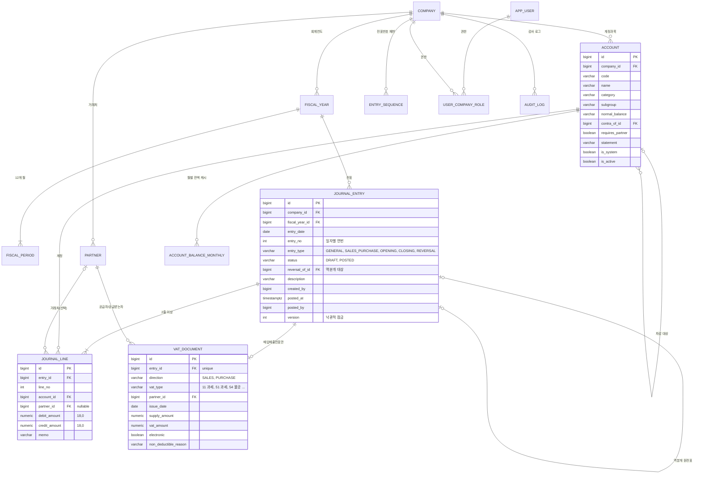

# 데이터 모델 (ERD)

핵심은 **전표(journal_entry)와 전표 라인(journal_line)만 원천 데이터**라는 점입니다.
원장, 시산표, 재무제표는 전부 이 두 테이블을 집계해서 만들고, `account_balance_monthly`는 조회 성능을 위한 캐시일 뿐
언제든 전표에서 다시 만들 수 있어야 합니다.

## 테이블 명세

### company · fiscal_year · fiscal_period

| 테이블 | 주요 컬럼 | 규칙 |
| --- | --- | --- |
| company | id, name, biz_reg_no, industry, created_at | |
| fiscal_year | id, company_id, term_no(기수), start_date, end_date, status(OPEN/CLOSED) | 회사별 기간 겹침 금지 |
| fiscal_period | id, fiscal_year_id, period_no(1~12), start_date, end_date, status(OPEN/CLOSED), closed_at, closed_by | 마감 단위는 월 |

### account · partner

| 테이블 | 주요 컬럼 | 규칙 |
| --- | --- | --- |
| account | [account-chart.md](account-chart.md)의 속성 전부 | UNIQUE(company_id, code) |
| partner | id, company_id, code, name, biz_reg_no, partner_type(CUSTOMER/VENDOR/BOTH/BANK/ETC), is_active | UNIQUE(company_id, code) |

### journal_entry · journal_line — 원천 데이터

| 규칙 | 구현 |
| --- | --- |
| 전표 번호는 회사·일자별 연번 | UNIQUE(company_id, entry_date, entry_no), `entry_sequence` 행 잠금으로 채번 |
| 라인 금액은 한쪽만 | `CHECK (debit_amount >= 0 AND credit_amount >= 0 AND (debit_amount = 0) <> (credit_amount = 0))` |
| 전표는 2줄 이상 | 앱 검증 (DB는 아래 트리거에서 함께 확인) |
| 차변 합계 = 대변 합계 | 앱 도메인 검증 + DB **지연 제약 트리거**(커밋 시점에 전표별 합계 비교) — [ADR-0006](../adr/0006-balance-check-in-app-and-db.md) |
| 전기된 전표는 불변 | status = POSTED인 전표의 라인 UPDATE/DELETE를 트리거로 거부 — [ADR-0003](../adr/0003-immutable-posted-journal.md) |
| 마감 기간 보호 | 전표 저장 시 해당 fiscal_period가 CLOSED면 거부 (앱 + 트리거) |
| 역분개 | REVERSAL 전표는 reversal_of_id 필수, 원전표 1장당 역분개 1장 (UNIQUE) |
| 거래처 필수 계정 | account.requires_partner = true인데 partner_id가 null이면 거부 |

인덱스 후보: `journal_line(account_id, entry_id)`, `journal_entry(company_id, entry_date)`, `journal_line(partner_id) WHERE partner_id IS NOT NULL`.
3단계에서 100만 건 데이터로 EXPLAIN ANALYZE를 보고 확정합니다.

### vat_document — 매입매출전표의 부가세 정보

매입매출전표 1장 = vat_document 1건. 유형 코드는 전산회계 프로그램 관행을 따릅니다 (번호는 공부하면서 대조).

| 방향 | 유형 | 의미 | 자동 분개 (예: 공급가 1,000,000 / 세액 100,000) |
| --- | --- | --- | --- |
| 매출 | 11 과세 | 세금계산서 매출 | (차) 외상매출금 1,100,000 / (대) 제품매출 1,000,000, 부가세예수금 100,000 |
| 매출 | 12 영세 | 영세율 세금계산서 | 세액 0 |
| 매출 | 13 면세 | 계산서 | 세액 0, 부가세 신고서 과세표준에 미포함 |
| 매출 | 17 카과 | 카드 매출 | 과세와 같은 분개, 신고서 다른 란 |
| 매입 | 51 과세 | 세금계산서 매입 | (차) 원재료 1,000,000, 부가세대급금 100,000 / (대) 외상매입금 1,100,000 |
| 매입 | 53 면세 | 계산서 매입 | 부가세대급금 없음 |
| 매입 | 54 불공 | 매입세액 불공제 | 세액을 비용·자산 원가에 포함 (예: 기업업무추진비 1,100,000) |
| 매입 | 57 카과 | 카드 매입 공제 | 과세와 같은 분개 |

### account_balance_monthly — 조회용 캐시

| 컬럼 | 설명 |
| --- | --- |
| company_id, fiscal_year_id, period_no, account_id | PK |
| debit_sum, credit_sum | 해당 월 전기 전표 라인 합계 |

전표 전기 시 같은 트랜잭션에서 갱신합니다. 정합성 테스트: 이 테이블 합계 = 전표 라인 재집계 (차이 0).

### 권한 · 감사

| 테이블 | 주요 컬럼 |
| --- | --- |
| app_user | id, login_id, password_hash, name, is_active |
| user_company_role | user_id, company_id, role(WRITER/APPROVER/ADMIN) |
| audit_log | id, company_id, entity_type, entity_id, action, before_json, after_json, actor_id, reason, created_at |

## 전표 상태

설계서의 "임시 → 승인 → 전기"를 **DRAFT → POSTED** 두 단계로 단순화했습니다. 승인 버튼을 누르는 순간 전기됩니다.
SAP처럼 승인과 전기를 나누면 "승인됐지만 장부엔 없는 전표"라는 상태를 하나 더 관리해야 하는데,
이 프로젝트 규모에선 얻는 게 없습니다. 결재선이 필요해지면 그때 ADR로 다시 결정합니다.

| 상태 | 수정 | 삭제 | 장부 반영 |
| --- | --- | --- | --- |
| DRAFT | 가능 | 가능 | 안 됨 |
| POSTED | 불가 | 불가 | 됨 — 정정은 REVERSAL 전표 |
